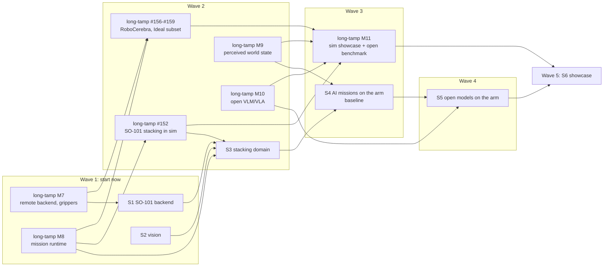

# Roadmap: long-tamp on real hardware

The goal is to show **all of long-tamp's capabilities on a physical SO-101**: an operator
gives an instruction, a model turns it into a goal, a task planner orders the steps, HPP
binds them to grasps and paths, the arm executes them under long-tamp's executor, a camera
keeps the world state current, and the mission recovers from disturbances. Open VLM and
VLA models come into the loop wherever they measurably do better than the deterministic
parts.

The tracker is GitHub: milestones **S1–S6** here and **M7–M11** in
[long-tamp](https://github.com/thanhndv212/long-tamp/milestones), with one tracking issue
listing everything ([#32](https://github.com/thanhndv212/soarm_tamp/issues/32)). This page
is the overview. Issue status on GitHub is authoritative; tick an item here when its issue
closes.

## Where we start

- The cube pick-and-place has run on the arm, with the cube at a known pose and no vision.
- Execution is `execute.py` streaming a manifest that long-tamp planned in the HPP
  container. It works, but it sits outside long-tamp's executor, so heartbeats, drift
  check, cancel, replan and recovery never reach the arm.
- long-tamp 0.8.0 has the task planner (PDDL), effects and resume, the executor contract,
  MuJoCo, the AI roles (goal writer, grounder, reviewer, supervisor) and the mission UI.
  The mission runtime that uses all of them is still example code in
  `script/screw_assembly/`, not library API.

## The demo

Three or four 30 mm cubes with ArUco markers, two or three named spots, one fixed camera.
Stacking suits the arm (top-down only, reach r = 0.10–0.30 m, ceiling about z = 0.08 m)
and exercises every layer:

| Layer | What the demo shows |
|---|---|
| AI | "Stack red on blue, then put green at spot C": the grounder resolves the cubes, the goal writer writes a checked goal |
| Task planner | Fast Downward finds that blue is covered and unstacks it first |
| Refiner | HPP finds grasps and collision-free paths on the constraint graph |
| Executor | The real arm runs through long-tamp's executor: heartbeats, drift check, cancel |
| World state | The camera observes cubes; steps already done are skipped; a killed mission resumes |
| Recovery | A cube moved by hand triggers a replan; a missed grasp is detected and retried |
| Supervisor and UI | The plan as a live behaviour tree, the 3D scene mirroring the arm, chat, escalation |
| Open models | A local VLM grounds and verifies from the image; a VLA skill handles recovery the planner can't (uprighting a tipped cube) |

Not shown: multi-arm concurrency (needs a second arm).

## Vision setup

Putting ArUco markers on the cubes and estimating their pose is most of the work, but not
all of it. Two more pieces decide whether a grasp succeeds:

1. **Camera-to-base extrinsics** ([#10](https://github.com/thanhndv212/soarm_tamp/issues/10)).
   A cube's pose in the camera frame is useless until the camera's pose in the arm's base
   frame is known. Calibrate it with a reference board, check it by eye-to-hand calibration
   with a marker on the gripper, and accept it only when the TCP touches 5 points within 3 mm.
2. **An accuracy budget** ([#11](https://github.com/thanhndv212/soarm_tamp/issues/11)). The
   planning jaw opens to 36.5 mm around a 30 mm cube: **3.25 mm per side**. The target is
   xy ≤ 2 mm and yaw ≤ 3°. A resting cube has three unknowns (x, y, yaw), so the estimator
   constrains the pose to the table plane and fuses every visible face.

Markers: `DICT_4X4_50` (larger cells than the current 6×6 at this size), about 22–24 mm on
the top and four side faces, with an id → (cube, face) map
([#9](https://github.com/thanhndv212/soarm_tamp/issues/9)). Detection and intrinsics already
exist in `camera_calibration`.

## Open models: adopted by measurement

A VLM or VLA replaces a part of the stack only where it beats that part on success and
recovery, measured on the same scenarios
([long-tamp #142](https://github.com/thanhndv212/long-tamp/issues/142),
[#147](https://github.com/thanhndv212/long-tamp/issues/147)). That makes S4's unattended
batch the **baseline** S5 is judged against. Rules that hold throughout:

- Every model proposal keeps a checker and a fallback.
- A model writes goals and facts, never motions. The one exception is a VLA, which acts
  only as a skill with pre- and postconditions, under the executor contract and the arm's
  safety envelope ([#20](https://github.com/thanhndv212/soarm_tamp/issues/20)).
- Candidates: a VLM grounder (from the image, not marker ids), a VLM outcome verifier, a
  VLM failure diagnoser, and a SmolVLA recovery skill with ACT as its baseline.
  `soarm-train` is a stub, so training uses LeRobot's own scripts.

## Delivery plan

The work runs in five waves. Inside a wave the tracks are independent. Simulation
runs ahead of the arm: long-tamp M10 (open models) starts in wave 2, and M11 shows the same
stacking mission in MuJoCo in wave 3, so the showcase exists in sim before S6 shows it on
the arm. The one library gate is long-tamp M8. The open benchmark, RoboCerebra (long-tamp
#156–#163), also needs long-tamp M7's remote backend; its first result (the Ideal condition)
lands in wave 2, and the full six-condition table closes M11.

| Wave | Tracks | Done when |
|---|---|---|
| 1 | long-tamp M7 + S1 (execution); S2 (vision, hardware only until #12); long-tamp M8 (library) | The cube pick-and-place runs 10× through the executor; a random cube is picked from the camera pose; screw assembly runs on `long_tamp.mission` |
| 2 | long-tamp #152 (the stacking domain, written once in sim) then S3; long-tamp M9; long-tamp M10 (#142–#146 can start in wave 1; #147 needs M8); RoboCerebra #156–#159 (after long-tamp #125 and M8) | Three goal types from four layouts on the arm; M10 benchmark report with an adoption decision per role; first RoboCerebra number (Ideal, pick/in/on subtasks) |
| 3 | S4 + long-tamp M11: RoboCerebra #160–#163 (pour, articulated objects, disturbance conditions, continuous variant) | 20 unattended instructions with disturbances on the arm (the baseline) and 20 in MuJoCo (the sim showcase); RoboCerebra results for all six conditions |
| 4 | S5 | Open models measured against the S4 baseline on the arm |
| 5 | S6 | Final batch, video, webpage, releases |

Labels: `type:*` and `area:*`, plus `needs-long-tamp` on issues blocked by a long-tamp
issue. Each issue lists its dependencies.

## Milestones

### S1 SO-101 as a long_tamp execution backend

The arm runs long_tamp's PlanExecutor through a host backend server: heartbeats, drift check from live joints, grasp verification. Exit test: the cube pick-and-place 10x on the arm through the executor.

- [ ] [#1](https://github.com/thanhndv212/soarm_tamp/issues/1) chore: pin long-tamp and add smoke tests + CI
- [ ] [#2](https://github.com/thanhndv212/soarm_tamp/issues/2) feat(execution): SO-101 as a long_tamp ExecutionBackend
- [ ] [#3](https://github.com/thanhndv212/soarm_tamp/issues/3) feat(execution): host backend server for the planning container — after long-tamp #125
- [ ] [#4](https://github.com/thanhndv212/soarm_tamp/issues/4) feat(grasping): SO-101 jaw as a long_tamp gripper model — after long-tamp #126
- [ ] [#5](https://github.com/thanhndv212/soarm_tamp/issues/5) feat(execution): grasp verification on the SO-101 — after long-tamp #127
- [ ] [#6](https://github.com/thanhndv212/soarm_tamp/issues/6) feat(execution): plan from the measured pose by default — after #2
- [ ] [#7](https://github.com/thanhndv212/soarm_tamp/issues/7) eval: S1 exit test, cube pick-and-place through the executor, 10 runs — after #3, #5, long-tamp #130

### S2 Vision: ArUco cubes and camera-to-base calibration

Fixed camera, ArUco-marked cubes, camera-to-base extrinsics, cube poses within the jaw's clearance budget. Exit test: pick a randomly placed cube from the camera pose alone, 10 trials.

- [ ] [#8](https://github.com/thanhndv212/soarm_tamp/issues/8) chore(hardware): fixed camera mount and intrinsics
- [ ] [#9](https://github.com/thanhndv212/soarm_tamp/issues/9) feat(vision): ArUco markers on the cubes — after #8
- [ ] [#10](https://github.com/thanhndv212/soarm_tamp/issues/10) feat(vision): camera-to-robot-base calibration — after #8
- [ ] [#11](https://github.com/thanhndv212/soarm_tamp/issues/11) feat(vision): cube pose estimator within the jaw's clearance budget — after #9, #10
- [ ] [#12](https://github.com/thanhndv212/soarm_tamp/issues/12) feat(vision): pose observer service for the planner — after #11, long-tamp #137
- [ ] [#13](https://github.com/thanhndv212/soarm_tamp/issues/13) eval: S2 exit test, pick a randomly placed cube from the camera pose — after #12, #7

### S3 Tabletop stacking domain

N cubes, K spots, pick/place/stack/unstack on long_tamp.mission, PDDL-planned from observed layouts, resume after kill. Exit test: three goal types from 4 layouts on the arm.

- [ ] [#14](https://github.com/thanhndv212/soarm_tamp/issues/14) feat(scene): parametric scene, N cubes and K spots
- [ ] [#15](https://github.com/thanhndv212/soarm_tamp/issues/15) study: stacking reachability on the 5-DOF arm
- [ ] [#16](https://github.com/thanhndv212/soarm_tamp/issues/16) feat(domain): tabletop stacking domain on long_tamp.mission — after long-tamp #152 (the domain is written once there, in sim), #15
- [ ] [#17](https://github.com/thanhndv212/soarm_tamp/issues/17) feat(domain): initial-state scenarios and resume after kill — after #16
- [ ] [#18](https://github.com/thanhndv212/soarm_tamp/issues/18) eval: S3 exit test, three goal types from four layouts on the arm — after #17, #13

### S4 AI-operated missions on the arm

Mission UI on the real arm, instruction to goal, supervisor, safety envelope, disturbance recovery. Exit test: 20 unattended instructions with disturbances; this is the baseline S5 must beat.

- [ ] [#19](https://github.com/thanhndv212/soarm_tamp/issues/19) feat(ui): mission UI on the real arm — after long-tamp #133, #3
- [ ] [#20](https://github.com/thanhndv212/soarm_tamp/issues/20) feat(safety): safety envelope for unattended runs
- [ ] [#21](https://github.com/thanhndv212/soarm_tamp/issues/21) feat(ai): instruction to goal on the arm — after #16, #19
- [ ] [#22](https://github.com/thanhndv212/soarm_tamp/issues/22) feat(recovery): disturbance recovery on the arm — after long-tamp #139, long-tamp #128, #5
- [ ] [#23](https://github.com/thanhndv212/soarm_tamp/issues/23) eval: S4 exit test, 20 unattended instructions with disturbances — after #21, #22, #20, #18

### S5 Open VLM/VLA in the loop on the arm

Local open VLM roles and a VLA recovery skill, each adopted only where it beats the S4 baseline on robustness and recovery.

- [ ] [#24](https://github.com/thanhndv212/soarm_tamp/issues/24) feat(ai): local open VLM for grounding and outcome checks — after long-tamp #143, long-tamp #144, long-tamp #145
- [ ] [#25](https://github.com/thanhndv212/soarm_tamp/issues/25) data: teleop demonstrations for recovery skills
- [ ] [#26](https://github.com/thanhndv212/soarm_tamp/issues/26) feat(skills): VLA recovery skill on the SO-101 — after #25, long-tamp #146
- [ ] [#27](https://github.com/thanhndv212/soarm_tamp/issues/27) eval: open models against the S4 baseline on the arm — after #24, #26, #23, long-tamp #147

### S6 Showcase release

Demo script, final batch on the arm, video, webpage, releases.

- [ ] [#28](https://github.com/thanhndv212/soarm_tamp/issues/28) docs: showcase demo script — after #23
- [ ] [#29](https://github.com/thanhndv212/soarm_tamp/issues/29) eval: final showcase batch on the arm — after #28, #27
- [ ] [#30](https://github.com/thanhndv212/soarm_tamp/issues/30) docs: video, webpage section and READMEs — after #29
- [ ] [#31](https://github.com/thanhndv212/soarm_tamp/issues/31) chore(release): soarm_tamp 0.2.0 and the matching long-tamp release — after #30, long-tamp #148

### long-tamp side (M7–M11)

The library work lives in long-tamp's own roadmap (`docs/plans/roadmap.md`) and
milestones; listed here so the whole plan reads in one place.

**M7 Hardware execution: remote backends and grippers (0.9.0).** Run long_tamp missions on a robot driven from another host, with grippers beyond symmetric parallel jaws and grasp verification as facts. Exit test: a mission runs through RemoteBackend on the SO-101 (soarm_tamp S1) and in MuJoCo.

- [ ] [long-tamp #125](https://github.com/thanhndv212/long-tamp/issues/125) feat(execution): remote execution backend over TCP
- [ ] [long-tamp #126](https://github.com/thanhndv212/long-tamp/issues/126) feat(grasping): gripper model interface beyond symmetric parallel jaws
- [ ] [long-tamp #127](https://github.com/thanhndv212/long-tamp/issues/127) feat(execution): gripper actuation and grasp verification facts
- [ ] [long-tamp #128](https://github.com/thanhndv212/long-tamp/issues/128) feat(task_planning): repair from grasp_missed
- [ ] [long-tamp #129](https://github.com/thanhndv212/long-tamp/issues/129) docs: run long_tamp on your robot
- [ ] [long-tamp #130](https://github.com/thanhndv212/long-tamp/issues/130) test: M7 exit test, a mission through RemoteBackend on a real robot

**M8 Mission runtime as a library (0.10.0).** Lift the mission runner, operator chat and mission UI launcher out of script/screw_assembly into long_tamp.mission behind a domain interface. Exit test: screw assembly unchanged on the library runner (V3 gate, autonomy batch); a second domain runs the full UI loop.

- [ ] [long-tamp #131](https://github.com/thanhndv212/long-tamp/issues/131) feat(mission): MissionDomain interface and long_tamp.mission package
- [ ] [long-tamp #132](https://github.com/thanhndv212/long-tamp/issues/132) feat(mission): generic mission runner
- [ ] [long-tamp #133](https://github.com/thanhndv212/long-tamp/issues/133) feat(mission): generic chat tools and mission UI launcher
- [ ] [long-tamp #134](https://github.com/thanhndv212/long-tamp/issues/134) refactor(script/screw_assembly): run on long_tamp.mission
- [ ] [long-tamp #135](https://github.com/thanhndv212/long-tamp/issues/135) feat(examples): template domain and "write your own mission" tutorial
- [ ] [long-tamp #136](https://github.com/thanhndv212/long-tamp/issues/136) test: M8 exit test, two domains on one runtime

**M9 Perception-backed world state (0.11.0).** Object poses from sensors feed predicates and the planning scene; an object moved mid-mission triggers a replan. Exit test in MuJoCo with a simulated camera.

- [ ] [long-tamp #137](https://github.com/thanhndv212/long-tamp/issues/137) feat(world_state): observed object poses and geometric predicates
- [ ] [long-tamp #138](https://github.com/thanhndv212/long-tamp/issues/138) feat(planning): planning scene from observed poses
- [ ] [long-tamp #139](https://github.com/thanhndv212/long-tamp/issues/139) feat(execution): object drift check and replan
- [ ] [long-tamp #140](https://github.com/thanhndv212/long-tamp/issues/140) feat(world_state): reconcile observation with belief
- [ ] [long-tamp #141](https://github.com/thanhndv212/long-tamp/issues/141) test: M9 exit test, object moved mid-mission in MuJoCo

**M10 Open VLM/VLA models in the loop (0.12.0).** Images in the gateway, local open models, VLM roles (grounder, verifier, diagnoser), learned-policy skills, and a benchmark that decides where a model replaces a rule. Exit test: benchmark report with adoption decisions.

- [ ] [long-tamp #142](https://github.com/thanhndv212/long-tamp/issues/142) docs(adr): open models in the loop, adopted by measurement
- [ ] [long-tamp #143](https://github.com/thanhndv212/long-tamp/issues/143) feat(ai): image inputs in the model gateway
- [ ] [long-tamp #144](https://github.com/thanhndv212/long-tamp/issues/144) feat(ai): local open-model serving profile
- [ ] [long-tamp #145](https://github.com/thanhndv212/long-tamp/issues/145) feat(ai): VLM roles, visual grounder, outcome verifier, failure diagnoser
- [ ] [long-tamp #146](https://github.com/thanhndv212/long-tamp/issues/146) feat(execution): learned-policy (VLA) skills
- [ ] [long-tamp #147](https://github.com/thanhndv212/long-tamp/issues/147) feat(eval): component benchmark harness
- [ ] [long-tamp #148](https://github.com/thanhndv212/long-tamp/issues/148) test: M10 exit test, benchmark report with adoption decisions

**M11 Simulation showcase and open benchmark.** The SO-101 stacking mission end to end in MuJoCo (language goals, simulated camera, disturbances, recovery), plus the RoboCerebra benchmark (chosen in long-tamp #150; LIBERO-based, long-horizon, scores disturbances and plan–observation mismatch). Gated on M8; the benchmark also needs long-tamp #125. Exit test: 20 sim missions and RoboCerebra results committed, before S6.

- [ ] [long-tamp #150](https://github.com/thanhndv212/long-tamp/issues/150) study: choose the open simulated benchmark
- [ ] [long-tamp #151](https://github.com/thanhndv212/long-tamp/issues/151) feat(sim): simulated camera, rendered views and marker poses
- [ ] [long-tamp #152](https://github.com/thanhndv212/long-tamp/issues/152) feat(examples): SO-101 tabletop stacking in MuJoCo
- [ ] [long-tamp #153](https://github.com/thanhndv212/long-tamp/issues/153) feat(eval): open benchmark adapter and baseline runs
- [ ] [long-tamp #154](https://github.com/thanhndv212/long-tamp/issues/154) test: M11 exit test, sim showcase and benchmark results
- [ ] long-tamp #153 split into RoboCerebra R1–R8: [#156](https://github.com/thanhndv212/long-tamp/issues/156) env server, [#157](https://github.com/thanhndv212/long-tamp/issues/157) scene exporter, [#158](https://github.com/thanhndv212/long-tamp/issues/158) grasps, [#159](https://github.com/thanhndv212/long-tamp/issues/159) goal translator + tracker + Ideal subset, [#160](https://github.com/thanhndv212/long-tamp/issues/160) pour, [#161](https://github.com/thanhndv212/long-tamp/issues/161) articulated objects, [#162](https://github.com/thanhndv212/long-tamp/issues/162) disturbance/mismatch/mix, [#163](https://github.com/thanhndv212/long-tamp/issues/163) continuous variant + tables

## Risks

- **Pose accuracy.** 3.25 mm per side is tight for a webcam at about 0.5 m. If #11 misses
  its budget: a closer or higher-resolution camera, larger markers on a bigger cube (which
  needs re-checking the jaw opening), or a wider planning jaw.
- **Reach.** The top-down ceiling (about z = 0.08 m) limits stack height, and three TCP
  targets at r ≈ 0.11–0.12 m still fail on shoulder/gripper self-collision. #15 turns
  both into domain constraints, and spots stay out of those regions.
- **5-DOF orientation coupling.** A tipped cube cannot be grasped top-down. Until the VLA
  skill (#26) exists, the mission escalates instead of recovering.
- **Servo behaviour.** Gravity droop leaves loaded joints 0.03–0.05 rad short at settle
  (see `execution-tuning.md`). Grasp verification thresholds (#5) must be measured under
  that, not derived from the model.
- **Local model latency.** An open VLM on the workstation may be too slow for a per-step
  verifier. The benchmark measures time as well as success.
- **Library extraction.** Moving the mission runtime into long-tamp (M8) must keep screw
  assembly's batch gate green, which takes hours per run.
